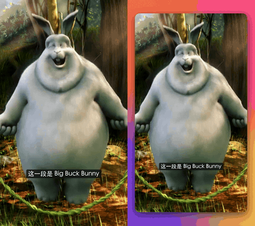
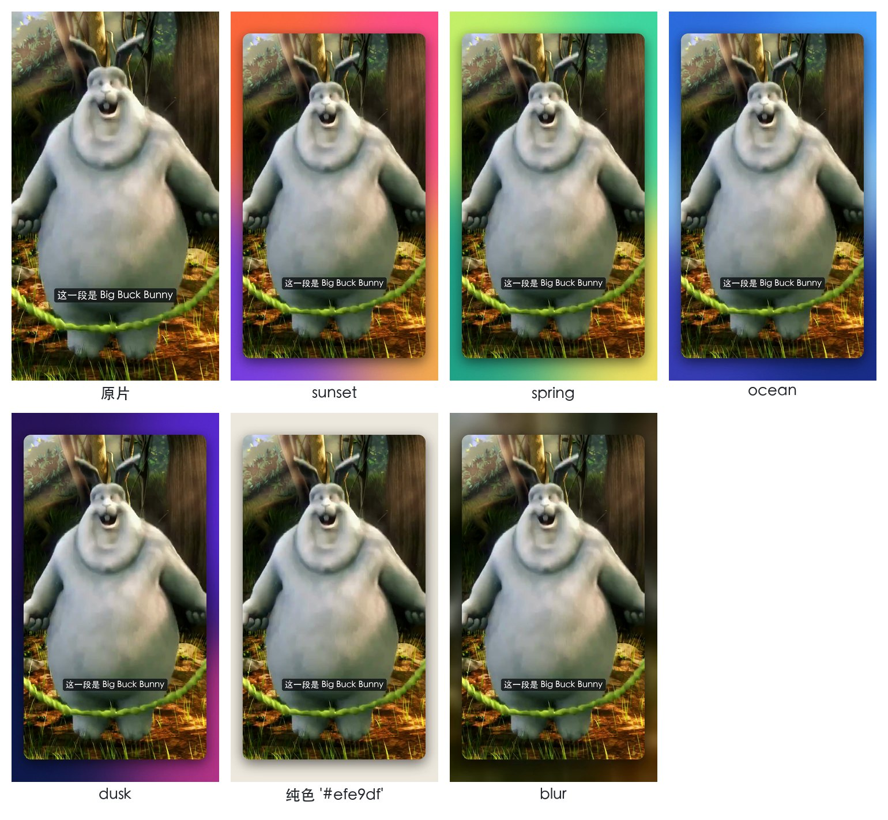
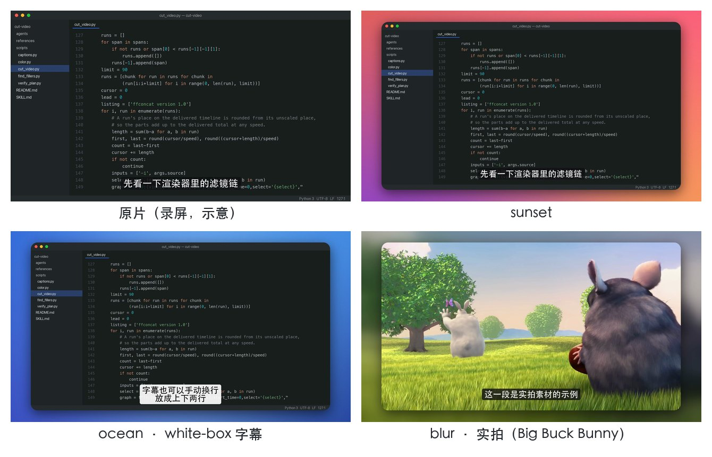
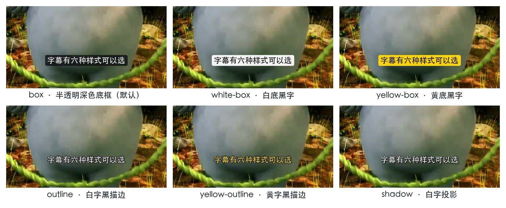
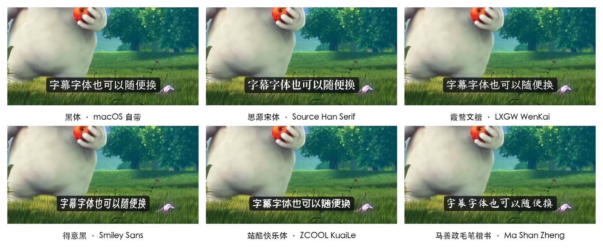

# cut-video · 视频剪辑 Skill

给 AI 助手（Claude Code、Codex 等）用的一个 Skill。把录好的视频交给它，口播、带解说的录屏、教程、实拍片段都行：剪掉「嗯、啊、呃」、掐头去尾、加同步字幕、倍速、加背景、换音色，这些可以任意组合，一次做完。输出可以直接发抖音 / TikTok 的 MP4。

视频全程在本机处理，不会上传；只有换音色时，会把字幕文字发给豆包语音合成。

## 效果演示

### 去语气词

一段 18.4 秒带解说的录屏，中间夹了 5 处语气词。划线部分是被剪掉的：

> 大家好。~~嗯，~~今天给大家介绍一个剪辑工具。~~呃，~~它可以自动找出视频里的语气词，~~啊，~~然后把它们剪掉。~~嗯，~~剪完之后，~~呃，~~说的内容一个字都不会少。

成片 13.8 秒。剪完重新识别一遍，语气词为 0 处，正文字数和原片一致。检查脚本的输出（节选）：

```
source    47 tokens, 52 content characters
edited    42 tokens, 52 content characters (+0)
OK        the cut removed only fillers and pauses
PASS
```

原片和成片可以下载试听：[剪辑前](docs/demo/fillers-before.mp4) · [剪辑后](docs/demo/fillers-after.mp4)

### 加背景

左边是原片，右边加了 sunset 背景：



竖屏视频配 4 种内置渐变、纯色和视频自身模糊：



横屏的录屏和实拍也一样，字幕放在卡片内底部：



### 字幕样式

6 种烧录样式：



### 字幕字体

字体可以换成任意 TTF / OTF / TTC 文件。除了 macOS 自带的黑体，下面几款都是免费可商用的开源字体：



<sub>演示素材：动画画面来自 [Big Buck Bunny](https://peach.blender.org/)，© Blender Foundation，[CC BY 3.0](https://creativecommons.org/licenses/by/3.0/)；录屏画面为示意；解说由 macOS 语音合成生成。</sub>

## 能做什么

- **去语气词**：剪掉「嗯、呃、啊」、um、uh 和多余停顿，保留完整内容，剪完会核对有没有误删。
- **掐头去尾、删片段**：按时间或画面描述剪，比如去掉前 5 秒、删掉中间卡住的一段。
- **加字幕**：生成跟剪辑后语音同步的 SRT，也可以烧进画面，6 种样式，字体可换。
- **修正 iPhone 过曝**：把发白的 HDR 视频转成正常亮度的 SDR。
- **加背景**：画面缩成圆角卡片放在背景上（类似 Screen Studio），背景可以是渐变、纯色、图片或模糊画面。
- **倍速**：0.5–5 倍，声音不变调，字幕同步。
- **换音色 / 配音**：用豆包语音的音色按字幕逐句重读，替换原声，也能给无声录屏配音（需要豆包语音 API Key）。
- **开头放钩子**：把指定的金句挪到视频开头。
- **剪精华版**：你要求时才剪，默认保留整段内容。

## 适合谁

✅ 适合

- 单人、单机位的口播、讲解、知识分享视频
- 录屏、教程、产品演示、游戏录像、实拍片段等单条视频
- 去语气词需要说中文或英文；其他剪辑不限语言
- 手机录的视频，尤其是 iPhone

❌ 不适合

- 多机位切换、多条素材拼接、插 B-roll、配乐、转场、特效：它一次处理一条视频，不是多轨剪辑软件
- 杜比视界 / HDR10（PQ）素材，或者需要输出 HDR 视频：目前只输出 H.264 / AAC 的 SDR MP4
- 中英文以外语言的去语气词：语气词识别只支持这两种，不影响其他剪辑

## 安装

把仓库克隆到你所用 AI 助手的 skills 目录：

```sh
# Claude Code
git clone https://github.com/Qsnh/cut-video.git ~/.claude/skills/cut-video

# Codex
git clone https://github.com/Qsnh/cut-video.git ~/.codex/skills/cut-video
```

## 使用

直接跟 AI 助手说你想要的效果，例如：

> 帮我剪一下 ~/Movies/IMG_0001.MOV，保留完整内容，去掉语气词，加同步中文字幕。

> 字幕换成黄字黑描边。

> 字幕用 ~/Downloads/SourceHanSansSC-Bold.otf 这个字体。

> 这段是 iPhone 拍的，画面太亮了，压一下曝光。

> 整条视频调成 1.25 倍速。

> 把声音换成豆包的 Vivi 音色。

> 给视频加个背景，用日落渐变。

> 背景换成 /System/Library/Desktop Pictures/Sonoma.heic，边距大一点。

> 把「90% 的人都做错了」这句挪到开头。

> 这段录屏去掉前 5 秒和语气词，整体 1.5 倍速，再加个海蓝背景。

视频里有人说话时，它会先识别语音、找出可能的语气词，逐个核对后再剪辑；你要的掐头去尾、倍速、背景等会合进同一次渲染。最后交付：

- 剪好的 MP4（每次都是新文件，原视频不动）
- 对应的 SRT 字幕文件（要求加字幕时）

## 协议

[AGPL-3.0](LICENSE)
